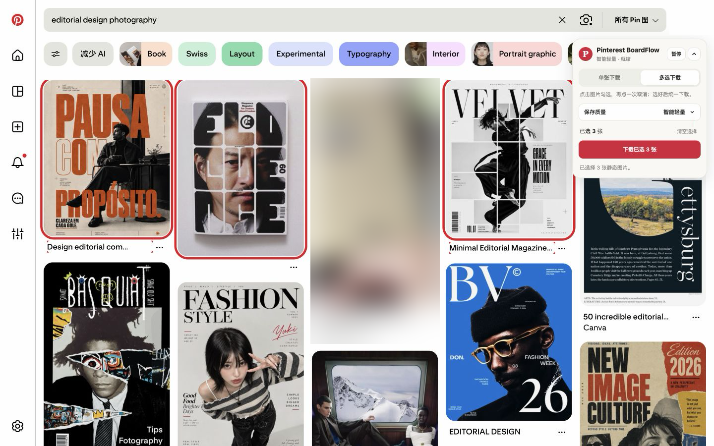
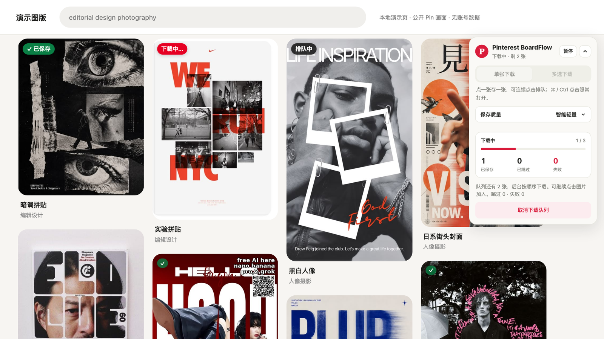
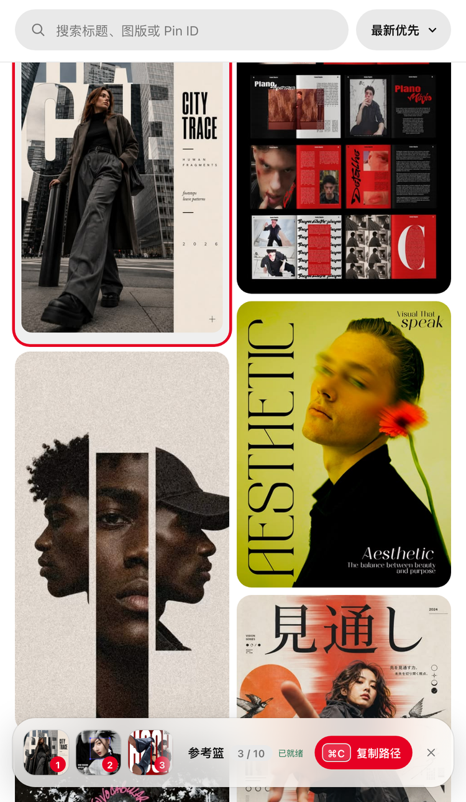

<div align="center">

# Pinterest BoardFlow

**把 Pinterest 上的灵感，变成 AI 能按顺序读取的参考图。**

Chrome 下载器 · 本地瀑布流素材库 · Codex / Claude Code 插件

   

[快速开始](#install) · [怎么用](#workflow) · [快捷键](#shortcuts) · [常见问题](#faq)

</div>

<p align="center">
  
</p>

<p align="center"><sub>在 Pinterest 上直接勾选、下载。真实页面截图，账号信息已遮挡，广告位已模糊。</sub></p>

在 Pinterest 找到好图之后，想让 AI 参考它们，通常要手动下载、改名，再一张张拖进对话。BoardFlow 把这件事缩成三步：

1. **收集**：在 Pinterest 上点一下，原图就存进本地素材库；
2. **挑选**：在本地瀑布流看板里搜索、预览，把要用的图按顺序放进参考篮；
3. **交给 AI**：回到 Codex 或 Claude Code 说一句话，AI 按编号读取这组原图。

<a id="workflow"></a>

## 怎么用

### ① 在 Pinterest 上收集

单张模式下点一张存一张，可以连续点击排队；多选模式勾好后一起下载；在图版页还能自动滚动、整板下载。下载器只取 Pinterest 的 originals 原图，不会用页面缩略图凑数。

<table>
  <tr>
    <td width="64%"></td>
    <td width="36%"></td>
  </tr>
  <tr>
    <td>每张图的状态直接标在卡片上：已保存、下载中、排队中；以前下过的图带一个小 ✓，整板下载时默认跳过。</td>
    <td>面板可以拖到任意位置，收起后是显示进度的小胶囊。点工具栏图标可隐藏面板，恢复 Pinterest 的正常点击。</td>
  </tr>
</table>

### ② 在本地看板里挑选

插件运行时，下载的图片会自动收进 `~/Pictures/PinterestInbox`，按图版分好文件夹。看板里可以搜索标题、图版或 Pin ID，按时间或标题排序。

<p align="center">
  
</p>

**点一下图片就加入参考篮**，再点一次移除。红色编号就是 AI 读取的顺序，在参考篮里拖动缩略图即可调整，最多 10 张。

<table>
  <tr>
    <td width="50%"></td>
    <td width="50%"></td>
  </tr>
  <tr>
    <td><strong>看清细节</strong>：点卡片右上角的放大按钮打开原图，双击或按 <kbd>Z</kbd> 放大到原尺寸。</td>
    <td><strong>按图版浏览</strong>：保留你在 Pinterest 上的分类，按项目或风格找图。</td>
  </tr>
</table>

### ③ 回到对话，交给 AI

在装好插件的新对话里说“打开 Pinterest BoardFlow”，看板会在旁边打开。选好图之后，回到同一个对话提需求就行：

> 用选中的参考图，先逐张看一遍。参考第 1 张的配色和第 2 张的版式，帮我设计一张活动海报。

AI 会通过插件拿到这组原图的本地路径，并实际打开每张图再动手。也可以按 <kbd>⌘C</kbd> 复制整组路径，粘贴到任何地方。

<table>
  <tr>
    <td width="30%"></td>
    <td width="70%"><strong>为侧边栏设计</strong><br><br>放在 Codex 或 Claude Code 旁边的窄面板里也好用：向下滚动时标题和标签自动收起，只留搜索栏；参考篮悬浮在底部，不占整行。<br><br>每个对话有自己的参考篮。选图不会自动发消息，你说话时 AI 才读取。</td>
  </tr>
</table>

<a id="install"></a>

## 快速开始

需要 **macOS**、**Chrome 116+**、**Node.js 20+**，以及 Codex 或 Claude Code 其中之一。

**1. 获取仓库**

```bash
git clone https://github.com/Panda-LJW/pinterest-boardflow-for-codex.git
cd pinterest-boardflow-for-codex
npm ci
```

**2. 安装 Chrome 下载器**

打开 `chrome://extensions`，开启右上角的“开发者模式”，点“加载已解压的扩展程序”，选择仓库里的 `extensions/pinterest-inbox-downloader/`。也可以从 [Releases](https://github.com/Panda-LJW/pinterest-boardflow-for-codex/releases/latest) 下载 zip，解压后加载。

**3. 安装 AI 插件**

在 Codex 中使用，在仓库目录运行：

```bash
codex plugin marketplace add "$PWD"
codex plugin add pinterest-reference-panel@personal
```

在 Claude Code 中使用，在 Claude Code 里输入（把路径换成仓库的实际位置）：

```text
/plugin marketplace add /path/to/pinterest-boardflow-for-codex
/plugin install pinterest-reference-panel@panda-ljw
```

**4. 开始使用**

打开 Pinterest，右上角会出现下载器面板。再开一个新对话，说“打开 Pinterest BoardFlow”。

<a id="shortcuts"></a>

## 快捷键

| 按键 | 作用 |
| --- | --- |
| 点击图片 | 加入 / 移出参考篮 |
| <kbd>⌘C</kbd> | 复制路径：预览中复制当前这张；参考篮有图时复制整组；否则复制鼠标下的那张 |
| <kbd>Esc</kbd> | 清空参考篮（预览打开时则是关闭预览） |
| <kbd>⌘Z</kbd> | 8 秒内撤销清空 |
| <kbd>空格</kbd> | 预览中：加入 / 移出参考篮 |
| <kbd>←</kbd> <kbd>→</kbd> | 预览中：上一张 / 下一张 |
| 双击 · <kbd>Z</kbd> | 预览中：放大到原尺寸，再按一次还原 |
| <kbd>Delete</kbd> 两次 | 预览中：把这张图移到废纸篓（可在访达里放回） |

<a id="faq"></a>

## 常见问题

<details>
<summary><strong>图片存在哪里？会不会被改动？</strong></summary>
<br>

| 位置 | 用途 |
| --- | --- |
| `~/Downloads/PinterestInbox/` | Chrome 的临时下载区 |
| `~/Pictures/PinterestInbox/` | 长期素材库，按图版分文件夹 |
| `~/Library/Caches/pinterest-reference-panel/` | 缩略图缓存，可以随时清理 |

插件会把临时区的文件校验后移进长期库。同名同内容自动去重，同名不同内容另存一份，不会覆盖旧图。文件名是“标题__pin-编号”，在访达里也好找。浏览、选图、复制路径都不会改动原图。

</details>

<details>
<summary><strong>保存质量选哪个？</strong></summary>
<br>

| 选项 | 效果 |
| --- | --- |
| 智能轻量（默认） | WebP 原样保存；其他格式缩到最长边 2048px，只有确实更小时才替换 |
| 原图 | 原始分辨率、原始字节、原始格式 |
| JPEG 高清 | 原分辨率的 JPEG；透明图片保存为 PNG |

视频 Pin 不会下载。更多细节见[下载器说明](extensions/pinterest-inbox-downloader/README.md)。

</details>

<details>
<summary><strong>看板没有在 AI 应用里打开？</strong></summary>
<br>

Codex 会尽量在右侧内嵌浏览器打开；如果只是排队没显示，让助手在可见浏览器里打开它返回的本地地址即可。Claude Code 桌面版的内置浏览器打不开本机地址时，会改用系统浏览器。选完图回到原对话继续说就行。

</details>

<details>
<summary><strong>更新之后还是旧界面？</strong></summary>
<br>

- **Chrome 下载器**：在 `chrome://extensions` 里点“重新加载”，再刷新已打开的 Pinterest 页面。
- **Codex**：Codex 按插件版本号缓存。拉取新版后，完全退出并重新打开 Codex，再开新对话。
- **Claude Code**：开一个新会话，再打开看板。

</details>

<details>
<summary><strong>会动我的 Pinterest 账号吗？</strong></summary>
<br>

不会。BoardFlow 不调用 Pinterest API，不读取账号凭证，也不会保存、修改或删除你在 Pinterest 上的任何内容。看板只在本机 `127.0.0.1` 上运行，不对局域网开放。

</details>

## 开发

```bash
npm run check   # 类型检查
npm test        # 构建插件，并运行插件与下载器的全部测试
```

| 目录 | 内容 |
| --- | --- |
| [`extensions/pinterest-inbox-downloader/`](extensions/pinterest-inbox-downloader/) | Chrome 下载器（Manifest V3） |
| [`plugins/pinterest-reference-panel/`](plugins/pinterest-reference-panel/) | AI 插件：MCP 服务、本地看板与测试 |
| [`SPEC.md`](SPEC.md) · [`docs/UX-PLAN.md`](docs/UX-PLAN.md) | 设计边界与验收标准 |
| [`LOG.md`](LOG.md) | 实施与验证记录 |

<details>
<summary>环境变量与插件接口</summary>
<br>

- `PINTEREST_INBOX_DIR` 覆盖长期素材库位置，`PINTEREST_INBOX_STAGING_DIR` 覆盖临时下载区。
- `open_pinterest_inbox_web` 打开看板并创建参考篮；`get_pinterest_reference_selection` 按同一个 `referenceSessionId` 返回有序的本地文件路径。
- 修改代码后要让 Codex 用上新版，需更新 `plugins/pinterest-reference-panel/.codex-plugin/plugin.json` 里的 `version`，再重启 Codex。

</details>

---

<sub>“怎么用”中的看板与下载器截图，来自 0.5 版代码在本地演示环境中的运行画面，使用公开 Pin 图片和模拟数据，不含任何账号或私人素材。图片版权归各自权利人所有。这是一个非官方的个人项目，与 Pinterest 没有隶属或背书关系，请确认你有权下载和使用相应素材。</sub>
