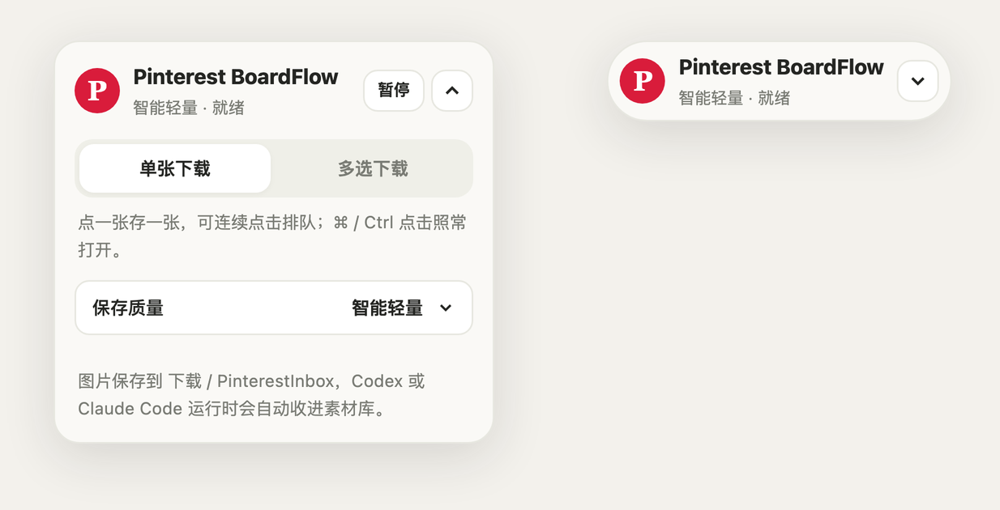
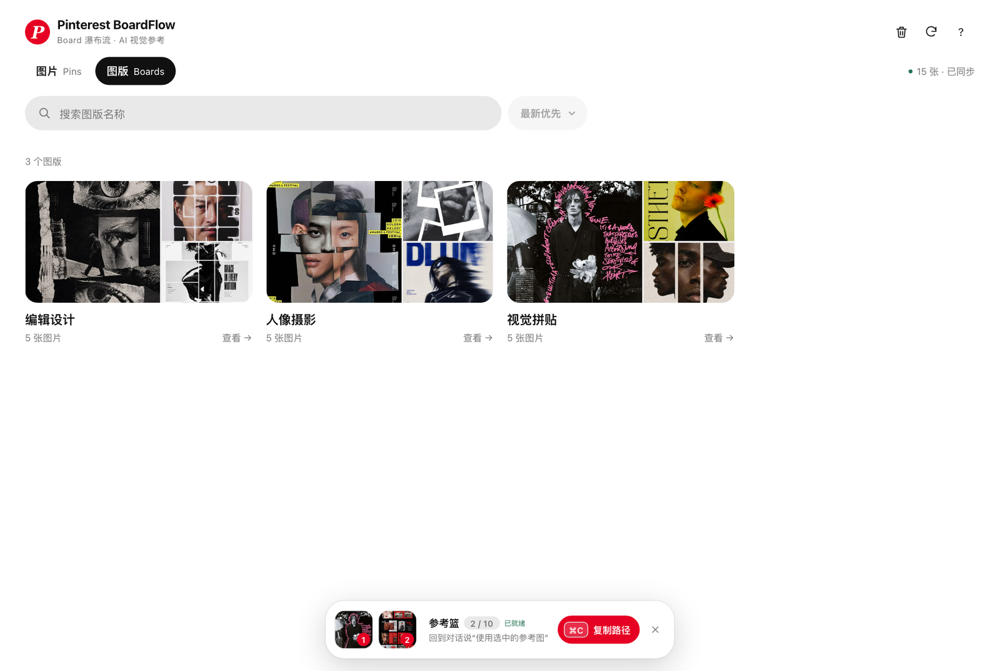
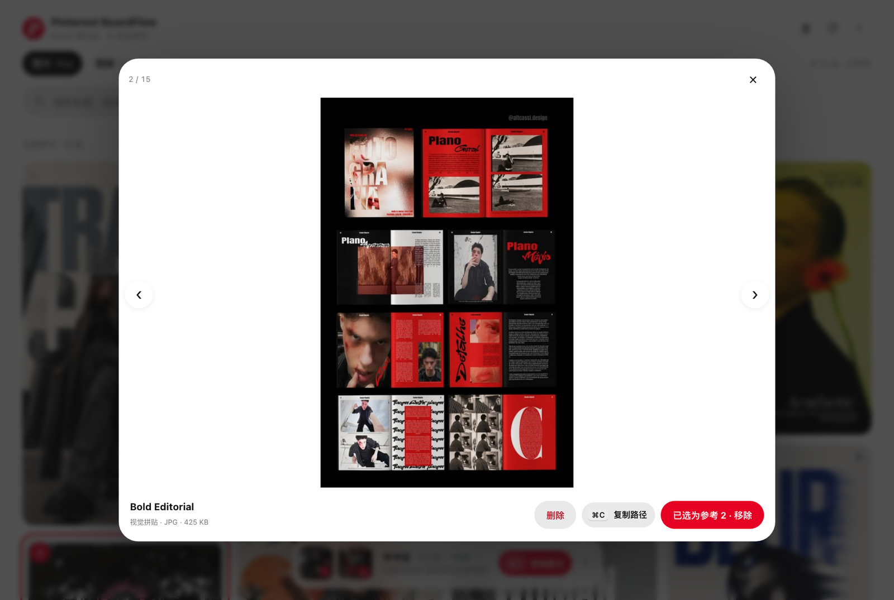

# Pinterest BoardFlow for Codex

**Pinterest 下载器 · Board 瀑布流看板 · Codex 视觉参考插件**

<p align="center">
  
</p>

一个面向 **macOS + Chrome** 的本地视觉参考工作流：Chrome 扩展把 Pinterest 静态图片下载到 `PinterestInbox`，插件在本机回环地址提供 Pins / Boards 瀑布流看板；点图片组成有序参考篮，交给 AI 助手按顺序读取原图，也可以按 `⌘C` 复制原文件的绝对路径。同时支持 **Codex** 与 **Claude Code**。

> **工作流：** Pinterest 原图下载 → 本地长期素材库 → Board 瀑布流浏览 → 有序参考篮 → Codex / Claude Code 读取原图

## 界面预览

以下截图拍摄于 0.4 版（0.5 的交互变化见下方“当前状态”）：Pinterest 页面使用真实公开搜索结果，BoardFlow 工作台使用同组公开 Pin 画面在隔离演示环境中呈现。账号入口已遮挡，**不包含用户名、邮箱、私人 Board、个人收藏或本机路径**。截图中的 Pin 缩略图仅用于说明产品界面，版权归各自权利人所有。

### 在 Pinterest 页面上直接收集

<table>
  <tr>
    <td width="72%"></td>
    <td width="28%"></td>
  </tr>
  <tr>
    <td><strong>下载器实际运行效果</strong><br>单张、多选和整板下载，选中态直接反馈在 Pin 上。</td>
    <td><strong>轻量控制面板</strong><br>设置保存质量，查看队列与下载进度。</td>
  </tr>
</table>

### 在 Codex 中浏览并组装参考图

<p align="center">
  
</p>

从长期素材库中搜索、预览和选图；参考篮保留明确顺序，交给 AI 助手时按 `01 / 02 / 03` 读取原文件。

<table>
  <tr>
    <td width="50%"></td>
    <td width="50%"></td>
  </tr>
  <tr>
    <td><strong>Boards 聚合</strong><br>保留 Pinterest 图版结构，适合按项目或风格浏览。</td>
    <td><strong>原图预览</strong><br>键盘翻图、查看信息，并直接加入当前参考篮。</td>
  </tr>
</table>

## 当前状态

当前版本：插件 **0.5.0**（Codex 清单为 `0.5.0+codex.<构建时间>`），Chrome 下载器 **0.5.0**。内部插件 ID `pinterest-reference-panel`、MCP 工具名和 `PinterestInbox` 目录保持不变，现有安装与素材兼容。

### 0.5.0 瀑布流看板

- **点图片即选择**：单击图片加入参考篮，再点一次移除；选中的图有红色描边和编号角标。右上角的放大按钮打开原图预览。
- **悬浮参考篮**：参考篮是悬浮在下方的圆角浮条，宽度随张数伸缩；空着时缩成一颗小胶囊。拖动缩略图调整顺序。
- **更大的看图空间**：向下滚动时标题和标签收起，只留搜索栏；向上滚动恢复。
- **键盘操作**：

  | 按键 | 作用 |
  | --- | --- |
  | `⌘C` | 复制路径：预览打开时复制这张；参考篮有图时复制整组；否则复制鼠标所在的那张 |
  | `Esc` | 清空参考篮（`⌘Z` 在 8 秒内撤销） |
  | `空格` | 预览里加入 / 移除参考 |
  | 双击 / `Z` | 预览里放大到原图尺寸，可拖动查看细节 |
  | `←` `→` | 预览里切换图片，到达已加载末尾时自动加载下一页 |
  | `Delete` ×2 | 预览里把图片移到废纸篓 |

- 排序改为带动画的下拉菜单；没有真实标题的 `pin 123…` 不再显示编号标题；缩略图并发加载更快。

### 0.5.0 Chrome 下载器

- 面板更紧凑：保存质量收进可展开的一行，多选控件只在多选模式出现，整板下载只在图版页出现。
- 面板可拖动并记住位置，收起后是显示进度的小胶囊，展开 / 收起以开合键为支点做弹簧动画。
- Pin 卡片上直接显示 排队中 / 下载中 / ✓ 已保存 / 下载失败；以前下过的图显示小 ✓，整板下载默认跳过（按住 ⇧ 全部重下）。
- Pin 详情页可“下载这张 Pin”；点击工具栏图标隐藏 / 显示面板。
- 后台队列在运行时保持活跃并镜像到会话存储，意外重启后继续下载；原图探测通常只需 1 个请求，并预取下一张。
- 重新加载扩展后未刷新的页面里，旧面板会自动让开，不再拦截点击。详见[下载器说明](extensions/pinterest-inbox-downloader/README.md)。

### 使用方法

在加载了插件的新任务 / 会话中说“打开 Pinterest BoardFlow”，点击 2–3 张图片加入参考篮；回到对话说“使用选中的参考图，按顺序分析”。AI 助手会读取本任务的有序原图列表，再实际查看原图。重新打开同一参考篮会复用原会话，另一个任务会创建空篮；插件进程重启后需要重新选图。主流程的设计与边界见 [SPEC](SPEC.md) 和 [UX 方案](docs/UX-PLAN.md)，验证与变更证据见 [LOG](LOG.md)。

素材工作台还支持完整素材库搜索、图版筛选、三种排序、系统深色、多选删除（移到废纸篓，可在访达中放回），以及最多 10 张的有序参考篮。Codex 中由宿主决定是否固定在右侧；若自动打开只进入排队，可在可见内嵌浏览器中打开工具返回的本地 URL。Claude Code 桌面版的内置浏览器无法打开本机地址时，会改用系统默认浏览器打开。

### 历史版本

- **0.4.2** 新增删图：工具栏垃圾桶进入多选删除，选中的图片在右下角叠成一摞，展开后点两次删除；大图预览里也可单张删除。
- **0.4.1** 品牌更新为 Pinterest BoardFlow。
- 2026-09-09 已在真实登录态 Pinterest、Chrome 扩展和 Codex 可见内嵌浏览器中完成端到端检查：连续点图去重、多选后取消、参考篮经 MCP 按相同顺序返回原文件，批量复制的路径与系统剪贴板逐字节一致（含中文文件名）。

## 已实现能力

- Chrome 单张、多选和整板自动滚动下载，面板内可暂停/启用采集；
- 只下载 Pinterest CDN `originals` 原图；优先原生 JPG/PNG，仅原图只有 WebP 时保留 WebP，不转码、不改假后缀、不回退缩略图；
- 以 `<标题>__pin-<Pin ID>.<格式>` 保存原图，同时保持可读性、去重与旧版文件兼容；
- Chrome 固定写入 `~/Downloads/PinterestInbox/<board>/` 临时区，Codex 插件校验后自动收取到 `~/Pictures/PinterestInbox/<board>/` 长期库；
- 静态图片过滤、串行限速、取消、失败重试一次和结果统计；
- MCP 启动完整扫描、运行期监听、10 秒周期校准与手动刷新；
- 收取时保留图版结构，SHA-256 校验成功后才清理临时副本；同名同内容去重，同名不同内容增加短哈希且不覆盖；
- `sips` 生成 480px JPEG 缩略图并独立缓存；
- 旧 MCP Pins / Boards 窄栏瀑布流与固定顶部栏；
- 旧 MCP 面板可把 Pin 安全复制到 `references/pinterest/<board>/` 并发送相对路径，作为回滚备用。

## 0.4.0 已验收能力

- 扩展面板提供“原图 / JPEG 高清 / 智能轻量”并记住用户选择；旧版本首次升级会迁移到默认“智能轻量”；
- 智能轻量遇到 WebP originals 直接保留原字节；其他格式只有在 2048px/JPEG80 或透明 PNG 候选件确实更小时才采用；
- `open_pinterest_inbox_web` 在当前 MCP 进程内懒启动仅绑定 `127.0.0.1` 动态端口的本地网页，并可在 Codex 右侧内嵌浏览器打开；
- 本地网页与 MCP 共用唯一 Inbox watcher；Pins / Boards 完整分页，监听状态和新素材自动刷新；
- 单击 Pin 只提交已索引 `assetId`，服务端重新确认路径边界后用 `pbcopy` 写入 canonical absolute path；不复制、不压缩、不修改素材，也不自动发送消息；
- 停止网页只释放 HTTP 服务，Inbox 监听和旧 MCP 回滚面板继续可用。

## 安装 Chrome 扩展

1. 从 [Releases](https://github.com/Panda-LJW/pinterest-boardflow-for-codex/releases/latest) 下载 `pinterest-boardflow-downloader-<版本>.zip` 并解压；或者直接使用仓库里的 `extensions/pinterest-inbox-downloader/`；
2. 在 Chrome 打开 `chrome://extensions`，开启“开发者模式”；
3. 点击“加载已解压的扩展程序”，选择解压出的文件夹（或仓库里的 `extensions/pinterest-inbox-downloader/`）。

打开 Pinterest 后，右上方会出现 Pinterest BoardFlow 控制面板。默认“单张模式”会拦截普通 Pin 单击并下载，默认保存质量是“智能轻量”；需要正常打开 Pin 时，点击面板上的“暂停”，或点击工具栏上的扩展图标隐藏面板。多选与整板模式会显示成功、跳过、无 originals 原图、图片处理失败和待处理数量。

**更新扩展**：在 `chrome://extensions` 里点扩展的“重新加载”，再**刷新已经打开的 Pinterest 页面**。只刷新网页不会加载新的后台程序。

## 安装 Codex 插件

```bash
git clone https://github.com/Panda-LJW/pinterest-boardflow-for-codex.git
cd pinterest-boardflow-for-codex
npm ci
npm test
codex plugin marketplace add "$PWD"
codex plugin add pinterest-reference-panel@personal
```

插件更新后需要开启一个新的 Codex 任务，新的 MCP 工具才会加载。主路线是调用 `open_pinterest_inbox_web`，保存返回的 `referenceSessionId`，把带 `?ref=<id>` 的 URL 打开到 Codex 可见内嵌浏览器。用户选图并提出需求后，调用 `get_pinterest_reference_selection` 读取同一参考篮。按 `⌘C` 复制路径再按 `⌘V` 粘贴的方式作为备用。旧 `render_pinterest_reference_panel` 继续保留为工作区导入回滚方案。

> **Codex 按版本号缓存本地插件。** 安装时 Codex 会把插件复制到 `~/.codex/plugins/cache/personal/pinterest-reference-panel/<版本号>/`，之后一直使用这份副本。修改代码后，需要更新 `plugins/pinterest-reference-panel/.codex-plugin/plugin.json` 中的 `version`（例如更新 `+codex.` 后面的构建时间），再完全退出并重新打开 Codex，它才会复制新文件。Codex 复制的是仓库当前检出的文件，切换分支也会影响它拿到的版本。

## 安装到 Claude Code

在 Claude Code 中运行：

```text
/plugin marketplace add /path/to/pinterest-boardflow-for-codex
/plugin install pinterest-reference-panel@panda-ljw
```

安装后开启新会话，输入 `/pinterest-reference-panel:pinterest-references` 或直接说“打开 Pinterest BoardFlow”。Claude Code 直接从仓库运行插件；修改页面文件后，重新打开面板（或开启新会话）即可看到新版本。

## 本地目录

```text
~/Downloads/PinterestInbox/                       # Chrome 临时下载区
~/Pictures/PinterestInbox/                        # 唯一长期素材库
~/Library/Caches/pinterest-reference-panel/       # 可安全清理的缩略图与引用衍生缓存
<workspace>/references/pinterest/<board>/         # 仅旧 MCP 回滚链路使用
```

可在启动 MCP 时通过 `PINTEREST_INBOX_DIR` 覆盖长期素材库，通过 `PINTEREST_INBOX_STAGING_DIR` 覆盖临时下载区。Chrome 扩展仍受 Downloads API 限制，只能下载到浏览器 Downloads 根目录下的相对路径。

## 本地开发与测试

```bash
npm ci
npm run check
npm test
```

`npm test` 会构建插件并依次运行插件测试与下载器测试。测试覆盖 Inbox 扫描与监听、缩略图路径复核、本地 HTTP 回环/会话/Origin 边界、剪贴板解析、Boards 完整分页、MCP 并发停止/重开与 EOF/SIGTERM 生命周期、旧工作区边界、UI 过期请求防护、扩展路径清理和下载队列。真实 Downloads 写入、Pictures 长期库存取、中文路径复制、参考篮会话到 MCP 原文件读取均已完成人工端到端验收，详见 [SPEC.md](SPEC.md)。

## 仓库结构

- `extensions/pinterest-inbox-downloader/`：Manifest V3 Chrome 下载扩展；
- `plugins/pinterest-reference-panel/`：Codex / Claude Code 插件、MCP 服务、UI、测试和运行时 bundle；
- `.agents/plugins/marketplace.json`：仓库内 Codex marketplace；
- `.claude-plugin/marketplace.json`：仓库内 Claude Code marketplace；
- `SPEC.md`：稳定边界、接口和验收标准；
- `LOG.md` / `LOG-INDEX.md`：施工决策、验证和回滚记录。

## 边界

- 不接 Pinterest API，不读取或保存账号凭证；
- 不搜索全站内容，不创建、保存、修改或删除 Pin；
- 不下载视频；
- MCP 与本地网页不接受任意 URL 或任意写入路径；
- 本地网页只绑定 `127.0.0.1`，默认使用动态端口，不提供 CORS；
- MCP 工具本身不强制宿主布局；Codex 桌面端支持时由代理把本地 URL 打开到右侧内嵌浏览器；
- 复制路径只写入系统剪贴板，页面不会向对话框注入内容或自动发送消息。

## 声明

这是一个非官方实验项目，与 Pinterest 无隶属或背书关系。请确认你有权下载和使用相应素材。
